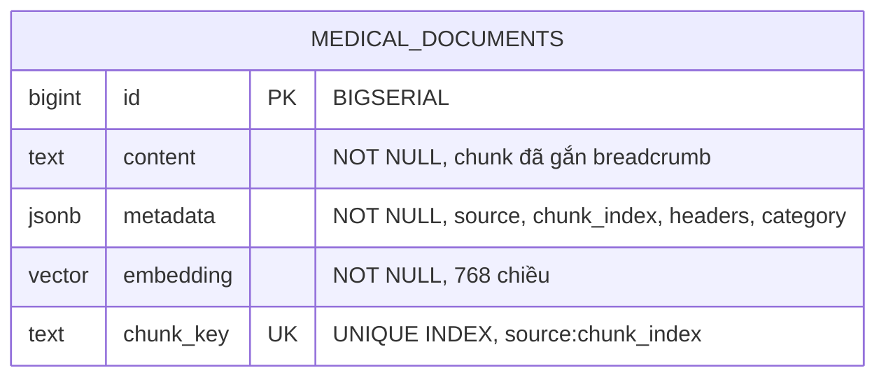

# Medical RAG Zalo - Lược đồ cơ sở dữ liệu

> Tài liệu này mô tả schema thực tế được tạo bằng DDL trong `app/db/pgvector_store.py`.
> Luồng ghi và đọc: [DATA_FLOW.md](./DATA_FLOW.md). Kiến trúc hạ tầng: [SYSTEM_ARCHITECTURE.md](./SYSTEM_ARCHITECTURE.md).

---

## 1. Công nghệ lưu trữ

| Thành phần | Công nghệ | Vai trò |
|---|---|---|
| Cơ sở dữ liệu quan hệ | PostgreSQL 16 (`pgvector/pgvector:pg16`) | Lưu chunk, metadata và vector |
| Extension | `pgvector` (`CREATE EXTENSION IF NOT EXISTS vector`) | Kiểu `vector` và toán tử khoảng cách |
| Driver | `asyncpg` kết hợp `pgvector.asyncpg.register_vector` | Truy vấn bất đồng bộ, không dùng ORM |
| Cache | Redis 7 | Chưa được sử dụng, xem [PROJECT_STATUS.md](./PROJECT_STATUS.md) |

Không có ORM model nào được định nghĩa. `app/models/chat_history.py` trống, và thư mục `app/models/` không có class nào.

---

## 2. Danh sách bảng

Hệ thống chỉ có **một bảng** duy nhất:

| Bảng | Mục đích | Khởi tạo bởi |
|---|---|---|
| `medical_documents` | Chunk tài liệu y khoa, metadata và vector embedding | `init_vector_db()` |

Các bảng `users`, `chat_sessions`, `chat_history` **không tồn tại** trong code.

---

## 3. Sơ đồ quan hệ



Không có quan hệ khóa ngoại. Bảng `medical_documents` không tham chiếu tới bảng nào khác, và không có bảng nào tham chiếu tới nó.

---

## 4. Định nghĩa các cột

| Cột | Kiểu | Ràng buộc | Nguồn ghi | Mô tả |
|---|---|---|---|---|
| `id` | `BIGSERIAL` | PRIMARY KEY | Tự sinh | Khóa định danh của bản ghi |
| `content` | `TEXT` | NOT NULL | `item["content"]` | Chunk đã gắn `Tiêu đề: ...` và `Nội dung: ...` |
| `metadata` | `JSONB` | NOT NULL | `json.dumps(item["metadata"], ensure_ascii=False)` | Xem mục 5 |
| `embedding` | `vector(768)` | NOT NULL | Kết quả `embed_documents` | Số chiều lấy từ `settings.EMBEDDING_DIMENSIONS` |
| `chunk_key` | `TEXT` | Nullable, có UNIQUE INDEX | `"{source}:{chunk_index}"` | Khóa upsert |

Lưu ý: `chunk_key` được thêm bằng `ALTER TABLE ... ADD COLUMN IF NOT EXISTS`, nên cột này **không** có NOT NULL. Tính duy nhất được đảm bảo bởi index `idx_medical_documents_chunk_key`, không phải bởi định nghĩa cột.

---

## 5. Cấu trúc JSONB `metadata`

```json
{
  "source": "<tên file PDF>",
  "chunk_index": 0,
  "headers": { "h1": "<tiêu đề cấp 1>", "h2": "<tiêu đề cấp 2>", "h3": "<tiêu đề cấp 3>" },
  "category": "tu_van_nha_thuoc"
}
```

| Khóa | Bắt buộc | Nguồn | Ghi chú |
|---|---|---|---|
| `source` | Có | `ingestion.extract_and_chunk_pdf` | Được dùng trong `chunk_key` và khi xóa theo file |
| `chunk_index` | Có | `chunk_markdown` | Chỉ số toàn cục trong tài liệu, bắt đầu từ 0 |
| `headers` | Không | `chunk_markdown` | Chỉ có các key h1, h2, h3 có giá trị |
| `category` | Không | `scripts/ingest_pdfs.py` | Dùng cho bộ lọc `category_filter` |

Không có khóa `page`. Vì vậy nhánh hiển thị "Trang N" trong `_format_retrieved_contexts` không bao giờ được kích hoạt.

---

## 6. Index

| Tên index | Loại | Cột / biểu thức | Tham số | Mục đích |
|---|---|---|---|---|
| (PK) | B-tree | `id` | - | Khóa chính |
| `idx_medical_documents_chunk_key` | B-tree UNIQUE | `chunk_key` | - | Hỗ trợ `ON CONFLICT (chunk_key) DO UPDATE` |
| `idx_medical_documents_embedding_hnsw` | HNSW | `embedding vector_cosine_ops` | `m = 16`, `ef_construction = 64` | Tìm kiếm láng giềng gần nhất theo cosine |

Tham số truy vấn HNSW: `SET LOCAL hnsw.ef_search = 64`, đặt trong transaction của `search_similar_vectors`.

**Index chưa có:** không có index trên `metadata->>'source'` hoặc `metadata->>'category'`. Lệnh xóa theo file và bộ lọc category đang quét tuần tự. Xem [TECHNICAL_DEBT.md](./TECHNICAL_DEBT.md) mục D-09.

---

## 7. Truy vấn chính

| Truy vấn | Hàm | Kiểu |
|---|---|---|
| Tạo extension, bảng, index | `init_vector_db` | DDL, `IF NOT EXISTS` |
| Upsert chunk | `insert_chunks_with_embeddings` | `executemany`, `INSERT ... ON CONFLICT (chunk_key) DO UPDATE SET content, metadata, embedding` |
| Tìm kiếm tương đồng | `search_similar_vectors` | `1 - (embedding <=> $1) AS similarity`, `WHERE similarity >= $2`, `ORDER BY embedding <=> $1 LIMIT $n` |
| Xóa theo file | `scripts/ingest_pdfs.py` -> `delete_existing_source` | `DELETE FROM medical_documents WHERE metadata->>'source' = $1` |

Toán tử `<=>` là cosine distance. `similarity = 1 - distance`, nên giá trị càng gần 1 càng giống.

Mọi tham số truy vấn đều dùng placeholder `$n`. Tên cột và toán tử được nối cứng trong chuỗi SQL, không đến từ người dùng.

---

## 8. Quản lý kết nối, session và transaction

### 8.1. Connection pool

| Thuộc tính | Giá trị | Nguồn |
|---|---|---|
| Thư viện | `asyncpg.create_pool` | `pgvector_store.get_db_pool` |
| `min_size` | 2 | Hardcode |
| `max_size` | 10 | Hardcode |
| DSN | Lấy từ `DATABASE_URL`, đổi `postgresql+asyncpg://` thành `postgresql://` | `_get_asyncpg_dsn` |
| Codec vector | Đăng ký cho từng kết nối mới bằng `register_vector` | Callback `init_conn` |
| Khởi tạo | Lazy, lần gọi đầu tiên | `get_db_pool` |
| Đóng | `close_db_pool()` | Chỉ được gọi từ `scripts/ingest_pdfs.py` và test |

Pool là biến module-level `_pool`. Không có pool riêng cho từng request.

### 8.2. Transaction

| Thao tác | Cách dùng kết nối | Transaction |
|---|---|---|
| `init_vector_db` | Một kết nối riêng để tạo extension, sau đó một kết nối từ pool | Không khai báo tường minh |
| `insert_chunks_with_embeddings` | `pool.acquire()` cho mỗi lô 200 dòng | Auto-commit theo từng `executemany` |
| `search_similar_vectors` | `pool.acquire()` + `conn.transaction()` | Tường minh, để `SET LOCAL` có phạm vi giới hạn |
| `delete_existing_source` | `pool.acquire()` | Auto-commit |

Việc xóa và ghi trong luồng nạp không được gom vào một transaction. Xem mục 8.3.

### 8.3. Rủi ro toàn vẹn dữ liệu

Trong luồng nạp, `delete_existing_source` chạy trước khi embedding. Nếu embedding hoặc upsert lỗi giữa chừng, file đó sẽ bị mất các bản ghi cũ và chỉ còn một phần bản ghi mới. Chi tiết: [TECHNICAL_DEBT.md](./TECHNICAL_DEBT.md) mục D-08.

---

## 9. Vai trò của vector store và cache

| Vai trò | Thành phần | Trạng thái |
|---|---|---|
| Vector store (semantic search) | `medical_documents` + HNSW | Đang dùng |
| Lưu metadata và nguồn trích dẫn | Cột `metadata` JSONB | Đang dùng |
| Cache câu hỏi và câu trả lời | Redis | Chưa dùng |
| Lưu lịch sử hội thoại | Không có | Chưa triển khai |

---

## 10. Quản lý schema và migration

- Không có công cụ migration (Alembic hoặc tương đương). Không có thư mục migration.
- Schema được tạo bằng `CREATE ... IF NOT EXISTS` trong `init_vector_db()`. Hàm này được gọi từ `scripts/ingest_pdfs.py` và `tests/test_phase5_vectorstore.py`, không được gọi khi app khởi động.
- Các thay đổi không tương thích ngược (ví dụ đổi `EMBEDDING_DIMENSIONS`) không được tự động áp dụng. Cần xóa hoặc tạo lại bảng thủ công.
