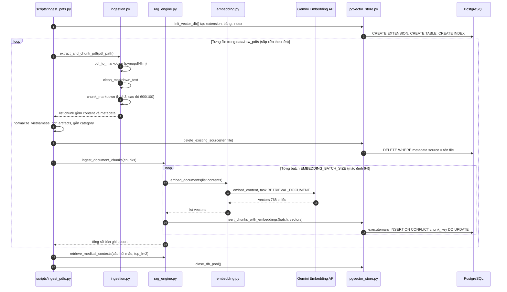
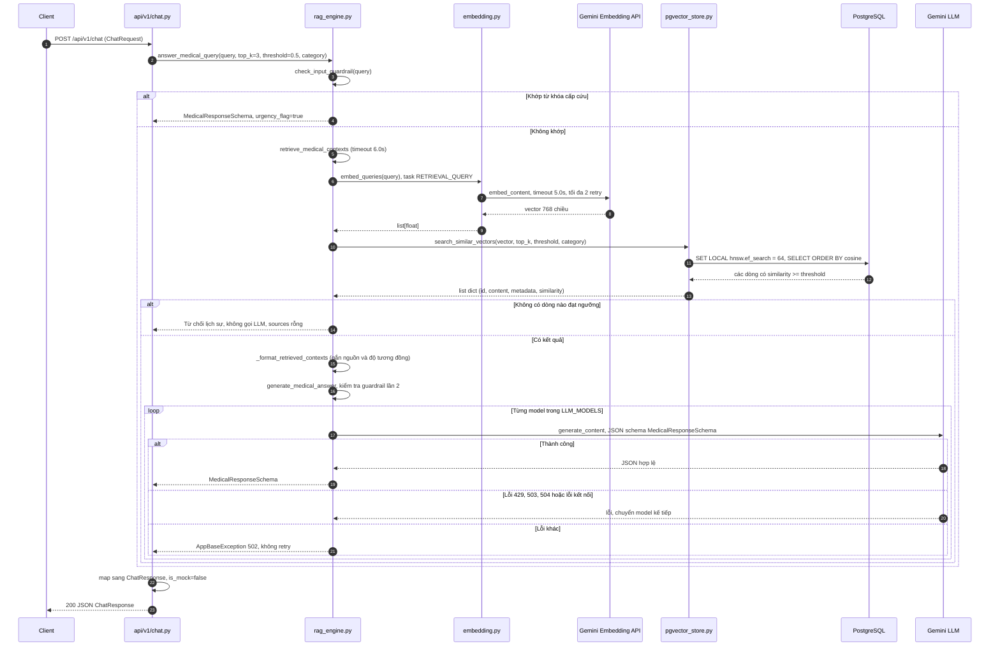

# Medical RAG Zalo - Luồng dữ liệu đầu cuối

> Tài liệu này mô tả luồng dữ liệu thực tế trong code. Kiến trúc tổng thể: [SYSTEM_ARCHITECTURE.md](./SYSTEM_ARCHITECTURE.md).
> Schema bảng: [DATABASE_SCHEMA.md](./DATABASE_SCHEMA.md). Request/response: [API_DOCUMENTATION.md](./API_DOCUMENTATION.md).

---

## 1. Tổng quan các luồng

| # | Luồng | Kích hoạt bởi | Điểm vào | Trạng thái |
|---|---|---|---|---|
| A | Nạp tài liệu (Ingestion) | Chạy thủ công script | `scripts/ingest_pdfs.py` -> `run_ingestion_pipeline` | Đã hoàn thiện |
| B | Hỏi đáp RAG | HTTP `POST /api/v1/chat` | `api/v1/chat.py` -> `answer_medical_query` | Đã hoàn thiện |
| C | Xử lý lỗi và fallback | Lỗi trong luồng B hoặc A | `generate_medical_answer`, `app_exception_handler` | Đã hoàn thiện |
| D | Tích hợp Zalo OA | Webhook Zalo | Chưa có | Chưa triển khai |

---

## 2. Luồng A: Nạp tài liệu (Ingestion)

### 2.1. Sơ đồ tuần tự



### 2.2. Chi tiết từng bước

| Bước | Hàm | Đầu vào | Đầu ra | Ghi chú kỹ thuật |
|---|---|---|---|---|
| 1 | `init_vector_db` | Không | Schema sẵn sàng | Mở một kết nối riêng để tạo extension trước khi pool đăng ký codec `vector` |
| 2 | `pdf_to_markdown` | Đường dẫn PDF | Chuỗi Markdown liền mạch | Lỗi đọc ném `AppBaseException` mã 422 |
| 3 | `clean_markdown_text` | Markdown thô | Markdown đã làm sạch | Chuẩn hóa `ƣ/Ư` thành `ư/Ư`; xóa dòng ngắn lặp từ 5 lần trở lên; xóa dòng chỉ chứa số trang |
| 4 | `chunk_markdown` | Markdown sạch, `source`, `chunk_size=600`, `chunk_overlap=100` | `list[dict]` | Tầng 1: `MarkdownHeaderTextSplitter` theo `#`, `##`, `###`. Tầng 2: `RecursiveCharacterTextSplitter` |
| 5 | `_with_breadcrumb` | Headers và nội dung | Chuỗi `Tiêu đề: ... \nNội dung: ...` | Breadcrumb được đưa **vào chính `content`**, nên nó được embed cùng nội dung |
| 6 | Chuẩn hóa trong script | Chunks | Chunks đã gắn `category` | `category` mặc định `tu_van_nha_thuoc` |
| 7 | `delete_existing_source` | Tên file | Số dòng đã xóa | Xóa toàn bộ chunk cũ của cùng `source` để chạy lại không trùng |
| 8 | `ingest_document_chunks` | Chunks | Số bản ghi upsert | Chia batch theo `EMBEDDING_BATCH_SIZE` |
| 9 | `embed_documents` | `list[str]` | `list[list[float]]` | Tuần tự (`EMBEDDING_MAX_CONCURRENCY=1`), cách nhau tối thiểu 12s |
| 10 | `insert_chunks_with_embeddings` | Chunks và vectors | Số bản ghi | `db_batch_size=200`, `executemany`, upsert theo `chunk_key` |
| 11 | Kiểm chứng | Câu hỏi mẫu cố định | In kết quả | Chỉ là bước kiểm tra thủ công, không assert |

### 2.3. Cấu trúc một chunk

```text
{
  "content": "Tiêu đề: <h1> > <h2> > <h3>\nNội dung: <đoạn văn>",
  "metadata": {
    "source":      "<tên file PDF>",
    "chunk_index": <số thứ tự toàn cục, bắt đầu từ 0>,
    "headers":     { "h1": "...", "h2": "...", "h3": "..." },   // chỉ có key nào có giá trị
    "category":    "tu_van_nha_thuoc"                           // gắn bởi script
  }
}
```

Khóa upsert: `chunk_key = "<source>:<chunk_index>"`, xem [DATABASE_SCHEMA.md](./DATABASE_SCHEMA.md).

### 2.4. Lưu ý về tính nhất quán

- Xóa dữ liệu cũ (bước 7) và ghi dữ liệu mới (bước 10) **không nằm trong cùng một transaction**. Nếu embedding lỗi giữa chừng, file đó sẽ mất dữ liệu cũ mà chưa có dữ liệu mới đầy đủ. Xem [TECHNICAL_DEBT.md](./TECHNICAL_DEBT.md) mục D-08.
- Nếu lỗi xảy ra, `run_ingestion_pipeline` dừng lại ở `finally: close_db_pool()` và không tiếp tục các file còn lại.

---

## 3. Luồng B: Hỏi đáp RAG (Online)

### 3.1. Sơ đồ tuần tự



### 3.2. Các bước xử lý

| Bước | Hàm | Điều kiện dừng sớm | Ghi chú |
|---|---|---|---|
| 1 | Pydantic `ChatRequest` | 422 nếu `message` ngoài 2..1000 ký tự hoặc thiếu `user_id` | Validation tự động của FastAPI |
| 2 | `check_input_guardrail` | Trả về ngay, không tốn DB hay LLM | So khớp chuỗi con (substring) với `EMERGENCY_KEYWORDS` |
| 3 | `retrieve_medical_contexts` | Ném `TransientServiceException` (503) nếu quá 6.0s | Bọc bằng `asyncio.wait_for` |
| 4 | `embed_queries` | Ném `TransientServiceException` nếu lỗi tạm thời sau 2 retry; `AppBaseException` 502 nếu lỗi không retry được | Backoff 0.5s đến 2s |
| 5 | `search_similar_vectors` | Trả về `[]` nếu không có dòng đạt ngưỡng | `category` được truyền dạng tham số, không nối chuỗi |
| 6 | Từ chối lịch sự | Khi `matches` rỗng | Không gọi LLM, không có nguồn |
| 7 | `_format_retrieved_contexts` | Không | Thêm `[Tài liệu i | Nguồn: ... | Độ tương đồng: ...]` trước mỗi chunk |
| 8 | `generate_medical_answer` | Guardrail lần 2 cũng có thể trả về sớm | Ghép `Context` và `Câu hỏi của người dùng` |
| 9 | `_call_gemini` | Fallback sang model kế tiếp khi lỗi 429, 503, 504 hoặc lỗi transport | Dùng `response.parsed`, nếu không có thì parse `response.text` |
| 10 | Map `ChatResponse` | Không | `is_mock=false`; `disclaimer` lấy từ kết quả LLM |

### 3.3. Giá trị mặc định trong luồng truy vấn

| Tham số | Giá trị | Nơi khai báo |
|---|---|---|
| `top_k` | 3 | Hardcode trong `api/v1/chat.py` |
| `similarity_threshold` | 0.5 | Hardcode trong `api/v1/chat.py` |
| `retrieval_timeout` | 6.0s | Mặc định của `retrieve_medical_contexts` |
| `EMBEDDING_QUERY_TIMEOUT` | 5.0s | `Settings` |
| Số lần retry embedding query | 2 | Hardcode trong `_embed_core` |
| `LLM_TIMEOUT_MS` | 30000 ms | Hằng số trong `rag_engine.py` |
| `thinking_level` | `low` | Cấu hình trong `_call_gemini` |
| `hnsw.ef_search` | 64 | Lệnh SQL trong `search_similar_vectors` |

---

## 4. Luồng C: Xử lý lỗi và fallback

### 4.1. Cây quyết định khi gọi LLM

```text
_call_gemini(model_i)
├── Thành công            -> trả MedicalResponseSchema
├── APIError code 429/503/504
│   ├── Còn model          -> thử model_i+1
│   └── Hết model          -> TransientServiceException (503, retryable=true)
├── TransportError / TimeoutError / ConnectionError
│   ├── Còn model          -> thử model_i+1
│   └── Hết model          -> TransientServiceException (503, retryable=true)
├── APIError code khác    -> AppBaseException (502, retryable=false), không fallback
└── Lỗi khác (parse, validate, rỗng) -> AppBaseException (502, retryable=false)
```

### 4.2. Bảng ánh xạ lỗi sang phản hồi HTTP

| Nguồn lỗi | Exception | HTTP | `error_type` | `retryable` |
|---|---|---|---|---|
| Quá 6.0s khi truy xuất | `TransientServiceException` | 503 | `TransientError` | true |
| Embedding lỗi tạm thời sau retry | `TransientServiceException` | 503 | `TransientError` | true |
| Tất cả model LLM quá tải | `TransientServiceException` | 503 | `TransientError` | true |
| Embedding lỗi không retry được | `AppBaseException` | 502 | `BusinessError` | false |
| LLM lỗi không thuộc danh sách fallback | `AppBaseException` | 502 | `BusinessError` | false |
| Lỗi không xác định khác (ví dụ DB) | `Exception` | 500 | `InternalServerError` | false |
| Validation request | `RequestValidationError` (FastAPI) | 422 | Định dạng mặc định của FastAPI | - |

Chi tiết format: [API_DOCUMENTATION.md](./API_DOCUMENTATION.md) mục 4.

---

## 5. Luồng D: Tích hợp Zalo OA (chưa triển khai)

Không có luồng dữ liệu nào cho Zalo trong code hiện tại. Các thành phần liên quan:

- `api/v1/router.py` có comment `api_router.include_router(zalo.router)`, nhưng chưa có module `zalo`.
- `app/schemas/zalo.py`, `app/services/zalo_service.py`, `tests/test_zalo_webhook.py` đều trống.
- `ZALO_APP_SECRET` và `ZALO_OA_ACCESS_TOKEN` được đọc vào `Settings` nhưng chưa được dùng.

Khi triển khai, luồng dự kiến sẽ đi qua `rag_engine.answer_medical_query` giống luồng B. Đây là giả định thiết kế, chưa có bằng chứng trong code.

---

## 6. Dữ liệu không đi qua hệ thống

Để tránh hiểu nhầm, các dữ liệu sau **không được lưu** ở bất kỳ bước nào trong code hiện tại:

- Nội dung câu hỏi và câu trả lời của người dùng (chế độ stateless, xem [PROJECT_STATUS.md](./PROJECT_STATUS.md)).
- `user_id` không được dùng trong xử lý, chỉ được nhận và bỏ qua.
- Không có cache câu hỏi hoặc câu trả lời (Redis chưa được kết nối).
