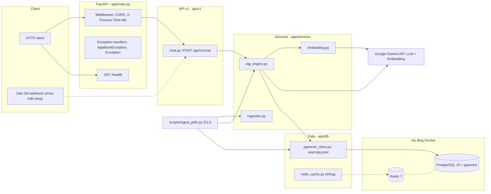

# Medical RAG Zalo - Kiến trúc hệ thống

> Phạm vi: kiến trúc tổng thể, phân tầng và hạ tầng. Chi tiết luồng xử lý: [DATA_FLOW.md](./DATA_FLOW.md).
> Chi tiết bảng và index: [DATABASE_SCHEMA.md](./DATABASE_SCHEMA.md). Chi tiết endpoint: [API_DOCUMENTATION.md](./API_DOCUMENTATION.md).

---

## 1. Sơ đồ tổng thể

Nét liền là đường đã có trong code. Nét đứt là thành phần chưa được kết nối (chỉ có khai báo hoặc hạ tầng).



---

## 2. Phân tầng

| Tầng | Thư mục / file | Trách nhiệm | Phụ thuộc chính |
|---|---|---|---|
| **Entry & Cross-cutting** | `app/main.py`, `app/core/*` | Khởi tạo app, CORS, đo thời gian xử lý, handler lỗi tập trung, cấu hình | FastAPI, pydantic-settings |
| **API** | `api/v1/router.py`, `api/v1/chat.py` | Nhận request, gọi service, map kết quả sang response | `app/schemas`, `rag_engine` |
| **Schema** | `app/schemas/chat_schema.py`, `app/schemas/medical.py` | Định nghĩa request, response và output LLM | Pydantic v2 |
| **Services (Business)** | `app/services/rag_engine.py` | Guardrail, điều phối RAG, gọi LLM, fallback model | `embedding`, `pgvector_store`, `google-genai` |
| **Services (Embedding)** | `app/services/embedding.py` | Gọi Gemini Embedding, retry, pacing, phân loại task type | `google-genai`, `tenacity` |
| **Services (Ingestion)** | `app/services/ingestion.py` | PDF -> Markdown -> làm sạch -> chunk 2 tầng | `pymupdf4llm`, LangChain splitters |
| **Data access** | `app/db/pgvector_store.py` | Pool asyncpg, DDL, upsert, tìm kiếm HNSW | `asyncpg`, `pgvector` |
| **Batch / CLI** | `scripts/ingest_pdfs.py` | Điều phối nạp toàn bộ PDF | `ingestion`, `rag_engine`, `pgvector_store` |

### 2.1. Quy tắc phụ thuộc thực tế

```text
api/v1/chat.py ──► services/rag_engine.py ──► services/embedding.py ──► Gemini API
                          │                          
                          ├──────────────────► db/pgvector_store.py ──► PostgreSQL
                          └──────────────────► Gemini API (LLM)

scripts/ingest_pdfs.py ──► services/ingestion.py
                       ──► services/rag_engine.py (ingest_document_chunks, retrieve_medical_contexts)
                       ──► db/pgvector_store.py
```

Lưu ý: `rag_engine.py` đang làm cả việc điều phối RAG lẫn luồng nạp tài liệu (`ingest_document_chunks`) và truy cập DB trực tiếp. Điều này được ghi nhận trong [TECHNICAL_DEBT.md](./TECHNICAL_DEBT.md).

---

## 3. Thành phần hạ tầng

### 3.1. PostgreSQL 16 + pgvector

- Image: `pgvector/pgvector:pg16`, khai báo trong `docker-compose.yml` (service `db`, port 5432).
- Vai trò: lưu **cả** văn bản chunk, metadata (JSONB) và vector embedding trong cùng một bảng. Không có vector DB riêng.
- Extension `vector` được tạo bởi `init_vector_db()`, không phải bởi container.
- Chi tiết: [DATABASE_SCHEMA.md](./DATABASE_SCHEMA.md).

### 3.2. Redis 7

- Image: `redis:7-alpine` (service `redis`, port 6379), bật `--appendonly yes`.
- Biến cấu hình: `REDIS_URL` trong `app/core/config.py`.
- **Trạng thái:** không có code nào kết nối Redis. `app/db/redis_cache.py` trống. Đây là hạ tầng chờ sử dụng, xem [PROJECT_STATUS.md](./PROJECT_STATUS.md).

### 3.3. Google Gemini API

Được dùng cho hai việc, mỗi việc có client riêng:

| Mục đích | Nơi tạo client | Model | Cách gọi |
|---|---|---|---|
| Embedding | `get_genai_client()` trong `embedding.py` (lazy) | `settings.EMBEDDING_MODEL` (mặc định `gemini-embedding-001`) | `client.aio.models.embed_content` |
| Sinh câu trả lời | `client` ở module level trong `rag_engine.py` (khởi tạo khi import) | Chuỗi `LLM_MODELS` | `client.aio.models.generate_content` với JSON schema |

### 3.4. Zalo OA

- Chỉ có biến cấu hình (`ZALO_APP_SECRET`, `ZALO_OA_ACCESS_TOKEN`) và một dòng comment trong `api/v1/router.py`.
- Không có webhook, không có service, không có schema. Xem [PROJECT_STATUS.md](./PROJECT_STATUS.md).

---

## 4. Cách các thành phần giao tiếp

| Từ | Đến | Giao thức / cách gọi | Ghi chú |
|---|---|---|---|
| Client | FastAPI | HTTP/JSON | Không có xác thực |
| API `chat.py` | `rag_engine.answer_medical_query` | Gọi hàm async trong cùng process | Tham số `top_k=3`, `similarity_threshold=0.5` được hardcode tại endpoint |
| `rag_engine` | `embedding.embed_queries` | Gọi hàm async | Timeout 6.0s bọc toàn bộ retrieval |
| `embedding` | Gemini Embedding | HTTPS qua `google-genai` | Retry qua `tenacity` |
| `rag_engine` | `pgvector_store.search_similar_vectors` | Gọi hàm async, pool asyncpg | Mỗi truy vấn chạy trong transaction |
| `rag_engine` | Gemini LLM | HTTPS qua `google-genai` | Fallback tuần tự qua `LLM_MODELS` |
| `scripts/ingest_pdfs.py` | Các service | Gọi hàm trực tiếp, chạy tuần tự từng file | Không có queue hay worker |

Toàn bộ hệ thống chạy trong **một process** Python. Không có message queue, không có worker tách rời.

---

## 5. Xử lý lỗi và đo lường

| Cơ chế | Vị trí | Mô tả |
|---|---|---|
| Exception nghiệp vụ | `app/core/exceptions.py` | `AppBaseException(message, status_code, retryable)` |
| Lỗi tạm thời | `TransientServiceException` | Mặc định HTTP 503, `retryable=True` |
| Handler tập trung | `app/main.py` | `app_exception_handler` và `unhandled_exception_handler` |
| Đo thời gian | `app/main.py` | Middleware `add_process_time_header` thêm header `X-Process-Time-Ms` |
| Logging | Module `logging` chuẩn trong từng service | Không có cấu hình tập trung (`app/core/logging.py` trống) |

Chi tiết mã lỗi và format response: [API_DOCUMENTATION.md](./API_DOCUMENTATION.md).

---

## 6. Ràng buộc kiến trúc quan trọng

1. **Số chiều vector cố định theo schema:** `vector({EMBEDDING_DIMENSIONS})` được tạo khi DDL chạy lần đầu. Đổi cấu hình không tự đổi cột đã tồn tại.
2. **Schema không có migration:** mọi thay đổi bảng phải làm thủ công hoặc qua `init_vector_db()`.
3. **Pool DB được tạo lazy và không đóng khi app tắt:** `close_db_pool()` chỉ được gọi từ script và test.
4. **Model LLM được cấu hình trong code:** danh sách `LLM_MODELS` nằm trong `rag_engine.py`, không đưa qua `Settings`.
