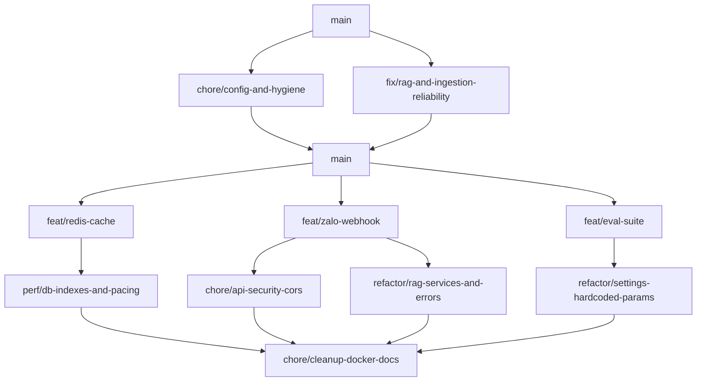

# Medical RAG Zalo - Nợ kỹ thuật

> Danh sách điểm nghẽn, phụ thuộc chặt, thiếu sót xử lý lỗi, validation, cấu hình và các việc cần refactor.
> Quyết định gốc sinh ra các điểm này: [TECHNICAL_DECISIONS.md](./TECHNICAL_DECISIONS.md).
> Trạng thái module: [PROJECT_STATUS.md](./PROJECT_STATUS.md).

**Mức độ:** Cao = ảnh hưởng an toàn, dữ liệu hoặc khả năng chạy được. Trung = ảnh hưởng bảo trì và hiệu năng. Thấp = vệ sinh mã nguồn.

---

## 1. Tổng hợp

| ID | Mức độ | Nhóm | Vấn đề ngắn | Vị trí |
|---|---|---|---|---|
| D-01 | Cao | Bảo mật | Không có xác thực trên endpoint chat | `app/core/security.py`, `api/v1/chat.py` |
| D-02 | Cao | Vận hành | App không khởi tạo schema và không đóng pool khi tắt | `app/main.py`, `app/db/pgvector_store.py` |
| D-03 | Cao | Bảo mật | Giá trị mặc định mật khẩu DB nằm trong code và không khớp với compose | `app/core/config.py`, `docker-compose.yml` |
| D-04 | Cao | Cấu hình | Biến Zalo bắt buộc dù chưa dùng, làm app không khởi động được | `app/core/config.py` dòng 28-29 |
| D-05 | Cao | Toàn vẹn dữ liệu | Xóa và ghi không atomic khi nạp lại tài liệu | `scripts/ingest_pdfs.py`, `rag_engine.py` |
| D-06 | Cao | Độ tin cậy | Chuỗi fallback có thể kéo dài hơn timeout của request | `rag_engine.py` |
| D-07 | Trung | Kiến trúc | `rag_engine.py` làm nhiều vai trò và truy cập DB trực tiếp | `app/services/rag_engine.py` |
| D-08 | Cao | Toàn vẹn dữ liệu | Lỗi giữa chừng làm mất dữ liệu cũ của file | `scripts/ingest_pdfs.py` dòng 71-80 |
| D-09 | Trung | Hiệu năng | Thiếu index cho `metadata->>'source'` và `metadata->>'category'` | `pgvector_store.py` |
| D-10 | Cao | Tính đúng đắn | `sources` do LLM tự sinh, không kiểm chứng | `rag_engine.py`, `medical.py` |
| D-11 | Trung | Bảo mật | CORS `allow_origins="*"` kết hợp `allow_credentials=True` | `app/main.py` |
| D-12 | Trung | Xử lý lỗi | `error_type` gắn `BusinessError` cho lỗi phía upstream | `app/core/exceptions.py`, `rag_engine.py` |
| D-13 | Trung | Xử lý lỗi | Phân loại lỗi tạm thời dựa trên khớp chuỗi thông báo | `embedding.py` `_is_transient_error` |
| D-14 | Trung | Cấu hình | Nhiều tham số quan trọng hardcode trong code | Nhiều file, xem mục 2.5 |
| D-15 | Trung | Kiến trúc | Hai `genai.Client` tách biệt với cấu hình khác nhau | `rag_engine.py`, `embedding.py` |
| D-16 | Trung | Validation | `category` và `user_id` không được kiểm tra định dạng | `app/schemas/chat_schema.py` |
| D-17 | Thấp | Tooling | `requirements.txt` lưu ở UTF-16, trộn phụ thuộc dev | `requirements.txt` |
| D-18 | Trung | Logging | Không có cấu hình logging tập trung và không có request ID | `app/core/logging.py` (trống) |
| D-19 | Trung | Kiểm thử | Test phụ thuộc DB và API thật, file test trống | `tests/` |
| D-20 | Thấp | Vệ sinh | Import và code chết, `list_models.py` có lỗi cú pháp | `chat.py`, `list_models.py` |
| D-21 | Trung | Hạ tầng | Redis và Dockerfile chưa dùng | `docker-compose.yml`, `Dockerfile` |
| D-22 | Trung | Tài liệu | `COMMANDS.md` và `README.md` không khớp với code | `COMMANDS.md`, `README.md` |
| D-23 | Trung | Hiệu năng | Module-level pacing không đồng bộ giữa nhiều process | `embedding.py` |
| D-24 | Trung | Dữ liệu | Thay đổi `EMBEDDING_DIMENSIONS` hoặc model không có đường migrate | `pgvector_store.py`, `embedding.py` |

---

## 2. Chi tiết theo nhóm

### 2.1. Bảo mật

#### D-01. Không có xác thực trên `POST /api/v1/chat`
- **Hiện trạng:** Endpoint mở công khai. `user_id` là chuỗi tự khai báo.
- **Rủi ro:** Ai cũng có thể gọi và đóng vai bất kỳ `user_id`. Không có cơ chế giới hạn tần suất, nên có thể bị lạm dụng và làm cạn quota Gemini.
- **Đề xuất:** Thêm dependency xác thực (API key header hoặc JWT) trong `app/core/security.py`, gắn vào router. Thêm rate limit theo client.

#### D-03. Mật khẩu DB mặc định trong code
- **Hiện trạng:** `Settings.POSTGRES_PASSWORD` có giá trị mặc định khác với giá trị mặc định trong `docker-compose.yml`. Hai giá trị này không đồng nhất (giá trị cụ thể không được ghi trong tài liệu).
- **Rủi ro:** Mật khẩu yếu có thể bị đưa lên repo. Cấu hình không khớp gây lỗi khó chẩn đoán khi chạy không có `.env`.
- **Đề xuất:** Bỏ giá trị mặc định cho mật khẩu, bắt buộc khai báo qua `.env`. Đồng bộ compose với biến môi trường. Đổi mật khẩu đã từng commit (xem mục 4.4).

#### D-11. CORS quá rộng
- **Hiện trạng:** `allow_origins=["*"]` và `allow_credentials=True` trong `app/main.py`.
- **Rủi ro:** Cấu hình không an toàn. Phản hồi trình duyệt có thể bị từ chối tùy trình duyệt, và làm khó chẩn đoán.
- **Đề xuất:** Liệt kê origin cụ thể từ `Settings`. Chỉ bật `allow_credentials` khi thực sự cần.

### 2.2. Vận hành và khởi tạo

#### D-02. Vòng đời ứng dụng không được quản lý
- **Hiện trạng:**
  - `app/main.py` không có `lifespan`.
  - `init_vector_db()` chỉ được gọi từ script và test. Nếu chạy app trên DB trống, mọi truy vấn sẽ lỗi.
  - `close_db_pool()` không được gọi khi app tắt.
- **Đề xuất:** Thêm `lifespan` để gọi `get_db_pool()` khi khởi động và `close_db_pool()` khi tắt. Cân nhắc gọi `init_vector_db()` có điều kiện theo `ENVIRONMENT`, hoặc tách thành lệnh riêng rõ ràng.

#### D-04. Biến Zalo bắt buộc
- **Hiện trạng:** `ZALO_APP_SECRET` và `ZALO_OA_ACCESS_TOKEN` không có giá trị mặc định, trong khi Zalo chưa được triển khai.
- **Rủi ro:** Người phát triển phải có giá trị giả để khởi động app. Có thể dẫn tới việc đưa giá trị thật vào file không an toàn.
- **Đề xuất:** Chuyển thành `Optional` với mặc định `None` cho đến khi triển khai Zalo. Bật bắt buộc khi có module Zalo.

#### D-21. Hạ tầng chưa đầy đủ
- **Hiện trạng:** Redis chạy trong compose nhưng không có code dùng. `Dockerfile` trống.
- **Rủi ro:** Tốn tài nguyên, và tài liệu có thể gây hiểu nhầm là đã có cache.
- **Đề xuất:** Hoặc triển khai cache (xem D-14 về giá trị cần cache), hoặc bỏ service Redis khỏi compose cho đến khi cần. Viết `Dockerfile` cho app nếu mục tiêu là triển khai container.

#### D-22. Tài liệu vận hành không khớp với code
- **Hiện trạng:** `COMMANDS.md` ghi `python main.py`, file này không tồn tại. `README.md` (301 dòng) chưa được đối chiếu.
- **Đề xuất:** Sửa `COMMANDS.md` thành `uvicorn app.main:app --reload`. Rà soát `README.md` theo [DATA_FLOW.md](./DATA_FLOW.md) và [PROJECT_OVERVIEW.md](./PROJECT_OVERVIEW.md).

#### D-23. Pacing không đồng bộ giữa process
- **Hiện trạng:** `_pace_lock` và `_last_request_started_at` là biến module-level trong `embedding.py`. `_pace_lock = asyncio.Lock()` được tạo khi import.
- **Rủi ro:** Với nhiều worker Uvicorn hoặc nhiều tiến trình nạp, giới hạn RPM không được tuân thủ toàn cục.
- **Đề xuất:** Pacing chỉ dành cho script nạp (chạy một tiến trình). Ghi rõ trong tài liệu vận hành rằng nạp không được chạy song song.

### 2.3. Toàn vẹn dữ liệu và nạp tài liệu

#### D-05. Xóa và ghi không atomic
- **Hiện trạng:** `delete_existing_source` chạy trước `ingest_document_chunks`. Hai bước này dùng hai kết nối và không có transaction chung.
- **Rủi ro:** Nếu embedding lỗi giữa chừng, file đó mất dữ liệu cũ và chỉ có một phần dữ liệu mới.
- **Đề xuất:**
  1. Embed toàn bộ chunk trước khi xóa.
  2. Gom xóa và ghi vào cùng một transaction.
  3. Hoặc đánh dấu phiên bản (`ingest_run_id`) và chỉ chuyển đổi khi hoàn tất.

#### D-08. Lỗi giữa chừng không được phục hồi
- **Hiện trạng:** `run_ingestion_pipeline` không có `try/except` theo file. Một lỗi làm dừng toàn bộ các file còn lại. Chỉ có `finally` đóng pool.
- **Đề xuất:** Ghi nhận trạng thái theo file (thành công, thất bại, số chunk). Cho phép chạy tiếp các file còn lại và báo cáo cuối cùng. Kết hợp với D-05.

#### D-09. Thiếu index cho lọc theo metadata
- **Hiện trạng:** `delete_existing_source` lọc `metadata->>'source'`. `search_similar_vectors` lọc `metadata->>'category'`. Không có index nào hỗ trợ hai biểu thức này.
- **Rủi ro:** Xóa theo file và lọc category quét toàn bảng khi dữ liệu tăng.
- **Đề xuất:** Tạo B-tree expression index `((metadata->>'source'))` và `((metadata->>'category'))`. Đo `EXPLAIN ANALYZE` sau khi có dữ liệu đủ lớn.

#### D-24. Thay đổi model hoặc số chiều không có đường migrate
- **Hiện trạng:** `vector({EMBEDDING_DIMENSIONS})` được tạo một lần. `CREATE TABLE IF NOT EXISTS` không đổi cột đã có.
- **Rủi ro:** Đổi model embedding hoặc số chiều làm vector cũ và mới không tương thích. Hệ thống không báo lỗi rõ ràng.
- **Đề xuất:** Lưu tên model và số chiều vào bảng metadata riêng, và kiểm tra khi khởi động. Khi đổi model, yêu cầu nạp lại toàn bộ.

### 2.4. Tính đúng đắn của câu trả lời

#### D-10. `sources` không được kiểm chứng
- **Hiện trạng:** Trường `sources` là kết quả của LLM theo schema. Prompt không yêu cầu LLM chỉ được trích dẫn nguồn có trong Context, và code không đối chiếu với `metadata.source` hay `headers`.
- **Rủi ro:** LLM có thể bịa tên tài liệu hoặc mục. Người dùng y tế có thể tin vào nguồn không tồn tại.
- **Đề xuất:**
  1. Bổ sung vào `SYSTEM_INSTRUCTION` yêu cầu chỉ trích dẫn từ danh sách nguồn đã cung cấp.
  2. Hậu xử lý: lọc `sources` chỉ giữ giá trị khớp với nguồn đã truy xuất.
  3. Hoặc gán `sources` từ metadata thay vì để LLM sinh.

#### D-06. Tổng thời gian chờ không có deadline
- **Hiện trạng:** Mỗi model LLM có timeout 30s. Với ba model, một request có thể chờ tới 90s trước khi trả 503. Phần truy xuất có timeout 6s riêng, nhưng không có deadline chung cho toàn request.
- **Rủi ro:** Client hết kiên nhẫn trước khi server phản hồi. Worker bị chiếm giữ lâu. Webhook của Zalo có thời gian chờ ngắn nên dễ bị timeout.
- **Đề xuất:** Thêm deadline tổng cho `answer_medical_query` (ví dụ `asyncio.timeout`), và truyền thời gian còn lại cho từng model. Với webhook, cân nhắc trả phản hồi ngay và xử lý nền.

### 2.5. Kiến trúc và phụ thuộc

#### D-07. `rag_engine.py` ôm quá nhiều trách nhiệm
- **Hiện trạng:** Cùng một module làm:
  - Guardrail
  - Điều phối retrieval
  - Gọi LLM và fallback
  - Luồng nạp tài liệu (`ingest_document_chunks`)
  - Import trực tiếp `pgvector_store` và `embedding`
- **Hệ quả:** `scripts/ingest_pdfs.py` phải import `rag_engine` để nạp, làm nó phụ thuộc vào cả module hỏi đáp.
- **Đề xuất:** Tách thành `services/retrieval.py` (retrieve), `services/generation.py` (LLM), `services/ingest_service.py` (nạp). Đưa `ingest_document_chunks` sang module nạp.

#### D-15. Hai client Gemini độc lập
- **Hiện trạng:** `rag_engine.client` được tạo khi import với `timeout=30000` ms và `attempts=1`. `embedding.get_genai_client()` tạo client riêng với timeout tính từ hai giá trị embedding.
- **Rủi ro:** Hai nơi phải đồng bộ cấu hình. Test mock phải mock cả hai.
- **Đề xuất:** Một factory duy nhất (`app/core/llm_client.py`) với cấu hình theo ngữ cảnh.

#### D-14. Tham số hardcode
Các giá trị sau nằm trong code thay vì cấu hình:

| Giá trị | Vị trí | Gợi ý |
|---|---|---|
| `top_k=3`, `similarity_threshold=0.5` | `api/v1/chat.py` | Đưa vào `Settings` |
| `LLM_MODELS` | `rag_engine.py` dòng 35-39 | Đưa vào `Settings` (danh sách) |
| `LLM_TIMEOUT_MS = 30_000` | `rag_engine.py` dòng 23 | `Settings` |
| `retrieval_timeout = 6.0` | `rag_engine.py` dòng 118 | `Settings` |
| `hnsw.ef_search = 64` | `pgvector_store.py` dòng 161 | `Settings` |
| `db_batch_size = 200` | `pgvector_store.py` dòng 98 | `Settings` |
| `chunk_size=600`, `chunk_overlap=100` | `ingestion.py` dòng 110-111 | Tham số CLI |
| `EMERGENCY_KEYWORDS` | `rag_engine.py` dòng 49-52 | File dữ liệu riêng để biên tập |
| `category` mặc định `tu_van_nha_thuoc` | `scripts/ingest_pdfs.py` dòng 35 | Tham số CLI |
| `SYSTEM_INSTRUCTION` | `rag_engine.py` dòng 43-47 | Tách file prompt |

### 2.6. Xử lý lỗi, validation và logging

#### D-12. `error_type` không phản ánh đúng nguồn lỗi
- **Hiện trạng:** `AppBaseException` với `retryable=False` luôn có `error_type="BusinessError"`, kể cả lỗi từ Gemini (502) hoặc lỗi cấu hình.
- **Đề xuất:** Thêm `error_type` riêng cho lỗi upstream, ví dụ `UpstreamError`. Giữ `retryable` đúng ngữ nghĩa.

#### D-13. Phân loại lỗi tạm thời dựa trên chuỗi
- **Hiện trạng:** `_is_transient_error` trả về `True` nếu thông báo lỗi chứa `"429"`, `"503"`, `"timeout"`... khi không khớp kiểu cụ thể.
- **Rủi ro:** Lỗi không liên quan nhưng có chứa số hoặc từ đó bị retry. Lỗi thật bị bỏ sót khi đổi ngôn ngữ thông báo.
- **Đề xuất:** Chỉ dựa vào `code` và kiểu exception. Bỏ nhánh khớp chuỗi.

#### D-16. Validation đầu vào chưa đủ
- **Hiện trạng:**
  - `category` là chuỗi tự do. Giá trị sai trả về danh sách rỗng mà không báo lỗi.
  - `user_id` không có ràng buộc định dạng và không được dùng.
  - `ChatRequest.message` không chuẩn hóa khoảng trắng trước khi kiểm tra guardrail.
- **Đề xuất:** Dùng `Literal` hoặc `Enum` cho `category` lấy từ danh sách hợp lệ. Thêm `strip()` cho `message`. Xác định `user_id` có được dùng cho log hay không.

#### D-18. Logging chưa có cấu hình chung
- **Hiện trạng:** `app/core/logging.py` trống. Chỉ `scripts/ingest_pdfs.py` gọi `basicConfig`. Không có request ID, và handler `Exception` không log.
- **Đề xuất:** Cấu hình logging trong `app/core/logging.py` và gọi trong `lifespan`. Thêm middleware gán request ID và log lỗi trong `unhandled_exception_handler`.

#### D-20. Code chết và lỗi vệ sinh
- **Hiện trạng:**
  - `api/v1/chat.py` import `generate_medical_answer` và `AppBaseException` nhưng không dùng (chỉ dùng trong code comment).
  - `TEMP_MEDICAL_CONTEXT` không được dùng.
  - Hai nơi cùng chuẩn hóa `ƣ/Ư` (`clean_markdown_text` và `scripts/ingest_pdfs.py`).
  - Guardrail được gọi hai lần trong một request (`answer_medical_query` và `generate_medical_answer`).
  - `list_models.py` dòng 8 có `-` thừa ở cuối, nhiều khả năng gây `SyntaxError`. Chưa chạy để xác minh.
- **Đề xuất:** Xóa code chết. Gom chuẩn hóa về một hàm. Chỉ gọi guardrail một lần ở tầng cao nhất.

### 2.7. Kiểm thử và công cụ

#### D-19. Kiểm thử phụ thuộc môi trường thật
- **Hiện trạng:** `tests/test_phase5_vectorstore.py` cần PostgreSQL và API key thật. `tests/test_schemas.py` và `tests/test_zalo_webhook.py` trống. Không có cấu hình CI.
- **Đề xuất:** Tách test đơn vị (mock Gemini, mock asyncpg) khỏi test tích hợp (đánh dấu `@pytest.mark.integration`). Bổ sung test cho guardrail, validator của `MedicalResponseSchema` và `ChatRequest`. Thêm bộ đánh giá RAG với câu hỏi mẫu.

#### D-17. `requirements.txt` có định dạng UTF-16 và trộn phụ thuộc
- **Hiện trạng:** File được lưu UTF-16 (có khoảng trắng giữa các ký tự khi đọc như văn bản UTF-8). Có `pytest` và `pytest-asyncio` nằm chung với phụ thuộc chạy.
- **Rủi ro:** Một số công cụ đọc file này không đúng. Phụ thuộc test được cài vào môi trường production.
- **Đề xuất:** Chuyển sang UTF-8. Tách `requirements-dev.txt`. Ghi phiên bản Python tối thiểu.

---

## 3. Phân loại theo nhóm công việc

Mỗi debt được xếp vào đúng một nhóm. Phân loại dựa trên một câu hỏi: **nếu để nguyên, có làm hỏng hoặc chặn việc thêm tính năng mới không?**

- **Vá ngay:** Có. Nền tảng (cấu hình, vòng đời, dữ liệu, hợp đồng nguồn trích dẫn) cần đúng trước khi thêm Redis và Zalo.
- **Làm sau:** Không. Là tối ưu bề mặt, đóng gói hoặc dọn dẹp, nên làm sau khi tính năng ổn định để tránh sửa lặp lại.

### 3.1. Vá ngay

| ID | Lý do phải làm trước | Việc cần làm |
|---|---|---|
| D-02 | Kết nối Redis và DB cần chung vòng đời với app qua `lifespan` | Thêm `lifespan` trong `app/main.py`, gọi `close_db_pool()` khi tắt |
| D-03 | Mọi cấu hình mới (Redis, Zalo) cần nền `Settings` sạch | Bỏ mật khẩu mặc định, đồng bộ với `docker-compose.yml`, đổi mật khẩu đã lộ |
| D-04 | Dev và test phải khởi động được khi chưa có Zalo | Chuyển `ZALO_APP_SECRET` và `ZALO_OA_ACCESS_TOKEN` sang `str \| None = None` |
| D-05 | Nạp lại tài liệu có thể làm mất dữ liệu | Xem mục 3.2 về cách sửa đúng |
| D-06 | Webhook Zalo có thời gian chờ ngắn, còn RAG có thể chờ tới 90 giây | Chốt cách xử lý: trả phản hồi ngay và xử lý nền, hoặc đặt deadline tổng |
| D-08 | Nạp tài liệu lỗi giữa chừng sẽ làm dừng cả lô, dữ liệu không nhất quán | Ghi trạng thái theo file, chạy tiếp các file còn lại, báo cáo cuối |
| D-10 | Nguồn trích dẫn sai sẽ gửi đến người dùng cuối | Ghi đè `sources` bằng metadata đã truy xuất (`source`, `headers`) |
| D-17 | Thêm thư viện mới vào `requirements.txt` cần file đọc được ổn định | Chuyển file sang UTF-8 |
| D-20 (một phần) | `list_models.py` có lỗi cú pháp, chặn việc kiểm tra model khả dụng | Sửa hoặc xóa dòng `-` thừa ở cuối file |

### 3.2. Lưu ý khi sửa nạp tài liệu (D-05)

Bỏ `DELETE` và chỉ dùng `ON CONFLICT` sẽ **để lại chunk mồ côi**. Khi một PDF được sửa và có ít chunk hơn, các dòng có `chunk_index` lớn hơn số chunk mới vẫn còn trong bảng. Cách sửa đúng, chạy trong một transaction:

1. `INSERT ... ON CONFLICT (chunk_key) DO UPDATE` cho toàn bộ chunk mới.
2. `DELETE FROM medical_documents WHERE metadata->>'source' = $1 AND (metadata->>'chunk_index')::int >= $2`, với `$2` là số chunk mới.

### 3.3. Làm sau

| ID | Lý do trì hoãn | Thời điểm gợi ý |
|---|---|---|
| D-01 | Xác thực `/api/v1/chat` là quyết định sản phẩm. Webhook Zalo có cơ chế xác minh chữ ký riêng | Trước khi public ra Internet |
| D-07 | Cache Redis có thể gắn ở `answer_medical_query` mà không cần tách module | Sau khi có cache và webhook ổn định |
| D-09 | Hiệu năng, chỉ cần khi số bản ghi lớn | Khi có dữ liệu thực, đo bằng `EXPLAIN ANALYZE` |
| D-11 | Webhook Zalo gọi phía server, không bị ảnh hưởng bởi CORS | Trước khi public ra Internet |
| D-12 | Thay đổi `error_type` ảnh hưởng hợp đồng API | Khi đã chốt hợp đồng với client và Zalo |
| D-13 | Chỉ ảnh hưởng độ chính xác của retry, không chặn tính năng | Sau khi có webhook ổn định |
| D-14 | Tham số Redis (TTL, key prefix) nên đưa vào `Settings` ngay khi viết. Phần còn lại làm sau | Phần Redis: cùng nhánh Redis. Phần còn lại: cuối dự án |
| D-15 | Chỉ tối ưu, không ảnh hưởng chức năng | Sau khi có webhook ổn định |
| D-16 | Validation `category` và `user_id` là việc mở rộng API | Cùng nhánh webhook |
| D-18 | Logging giúp debug, nhưng không chặn viết code | Khi gặp khó khăn debug, hoặc cuối dự án |
| D-19 | Test nên viết cùng từng tính năng, không gom một lần | Cùng nhánh từng tính năng |
| D-20 (phần còn lại) | Xóa code chết không ảnh hưởng chức năng | Dọn dẹp cuối cùng |
| D-21 | `Dockerfile` và đóng gói stack đầy đủ chỉ có ý nghĩa khi đã có đủ thành phần | Cuối dự án |
| D-22 | Tài liệu cập nhật sau cùng. Riêng sửa `COMMANDS.md` có thể làm sớm vì rủi ro thấp | Sửa `COMMANDS.md` sớm, phần còn lại cuối dự án |
| D-23 | Chỉ ảnh hưởng khi chạy nhiều worker Uvicorn | Khi triển khai nhiều worker |
| D-24 | Không dự kiến đổi embedding trong Redis và webhook. Bảng phiên bản model phục vụ đánh giá | Cùng nhánh bộ đánh giá RAG |

### 3.4. Thứ tự ưu tiên theo rủi ro

Thứ tự ưu tiên theo rủi ro, không ước lượng thời gian:

1. **Bảo mật và cấu hình:** D-01, D-03, D-04, D-11.
2. **Toàn vẹn dữ liệu:** D-05, D-08, D-24.
3. **Vòng đời và vận hành:** D-02, D-22, D-21.
4. **Tính đúng đắn của câu trả lời:** D-10, D-06.
5. **Tách kiến trúc và cấu hình:** D-07, D-14, D-15, D-23.
6. **Xử lý lỗi, validation, logging:** D-12, D-13, D-16, D-18, D-20.
7. **Kiểm thử và công cụ:** D-17, D-19, D-09.

---

## 4. Chiến lược nhánh cho dự án Solo Developer

Dự án do một người phát triển, nên chiến lược giữ số nhánh ít và tách theo **tầng rủi ro**, không tách theo từng ID debt. Mỗi nhánh gom một cụm việc cùng bản chất, và có các commit nguyên tử theo Conventional Commits.

### 4.1. Nguyên tắc

- **Tách theo tầng rủi ro:** nhóm sửa cấu hình và dọn dẹp không đụng logic RAG/DB. Nhóm sửa logic RAG và kết nối DB nằm ở nhánh riêng.
- **Ít nhánh, commit nhỏ:** mỗi debt là một commit. Nhánh là đơn vị gộp, commit là đơn vị lịch sử và có thể revert riêng.
- **Mỗi commit phải chạy được:** app khởi động và test đơn vị pass sau mỗi commit.
- **Gộp bằng `--no-ff`** để giữ dấu vết nhánh trong lịch sử.
- **Không commit secret.** Dùng `.env` (đã có trong `.gitignore`).

Mô hình nhánh:

| Nhánh | Vai trò | Nguồn tạo | Gộp vào |
|---|---|---|---|
| `main` | Mã ổn định, luôn chạy được | - | - |
| `chore/config-and-hygiene` | Vá ngay: cấu hình, bảo mật, dọn dẹp | `main` | `main` |
| `fix/rag-and-ingestion-reliability` | Vá ngay: vòng đời kết nối, độ tin cậy RAG và nạp dữ liệu | `main` | `main` |
| `feat/redis-cache` | Tính năng Redis | `main` | `main` |
| `feat/zalo-webhook` | Tính năng Zalo OA | `main` | `main` |
| `feat/eval-suite` | Bộ đánh giá RAG | `main` | `main` |
| `chore/*`, `refactor/*`, `perf/*`, `fix/*` (làm sau) | Gom theo bản chất, xem mục 4.3 | `main` | `main` |
| `hotfix/<tên>` | Chỉ khi đã deploy và có lỗi khẩn cấp | `main` | `main` |

Các nhánh đều tách từ `main` theo yêu cầu. Sau khi gộp, `main` là nguồn duy nhất để tách nhánh tiếp theo, nên không cần nhánh `develop`.

### 4.2. Nhóm Vá ngay: 2 nhánh

#### Nhánh 1: `chore/config-and-hygiene`

Xử lý cấu hình, bảo mật và dọn dẹp. Không đụng logic RAG hay DB.

| Thứ tự commit | Commit (Conventional Commits) | Debt | Ghi chú |
|---|---|---|---|
| 1 | `chore(requirements): convert requirements.txt to utf-8` | D-17 | Thay đổi định dạng, không đổi nội dung |
| 2 | `fix(config): make zalo settings optional` | D-04 | Chuyển `ZALO_*` sang `str \| None = None` |
| 3 | `fix(config): remove default database password` | D-03 | Bắt buộc `.env`, đồng bộ `docker-compose.yml` |
| 4 | `fix(scripts): repair syntax error in list_models.py` | D-20 (một phần) | Xóa `-` thừa ở dòng 8 |
| 5 | `docs(commands): correct run command to uvicorn` | D-22 (một phần) | Tùy chọn, có thể gộp vào nhánh khác |

Lưu ý với commit 3: đổi mật khẩu thật ở mọi môi trường đang dùng trước khi merge. Xem mục 4.4.

#### Nhánh 2: `fix/rag-and-ingestion-reliability`

Xử lý vòng đời kết nối và độ tin cậy dữ liệu AI. Đụng `app/main.py`, `rag_engine.py`, `scripts/ingest_pdfs.py`.

| Thứ tự commit | Commit (Conventional Commits) | Debt | Ghi chú |
|---|---|---|---|
| 1 | `fix(app): close db pool on shutdown via lifespan` | D-02 | Điểm gắn `init_redis_pool` và `close_redis_pool` về sau |
| 2 | `fix(rag): take sources from retrieved metadata` | D-10 | Ghi đè `sources` từ `metadata.source` |
| 3 | `fix(rag): bound total answer latency` | D-06 | Dùng `asyncio.timeout` cho toàn request |
| 4 | `fix(ingest): upsert chunks before pruning stale ones` | D-05 | Theo mục 3.2, trong một transaction |
| 5 | `fix(ingest): isolate per-file failures` | D-08 | Ghi trạng thái theo file, chạy tiếp các file còn lại |

Commit 4 và 5 có test tích hợp cần PostgreSQL thật. Chạy trước khi gộp.

#### Quan hệ giữa hai nhánh

Hai nhánh tách từ `main` và không sửa cùng một file, nên có thể merge theo thứ tự nào cũng được. Gợi ý merge `chore/config-and-hygiene` trước, vì nó nhỏ và đổi cấu hình mà các nhánh sau dùng.

### 4.3. Nhóm Làm sau: nhánh gọn, thực hiện sau khi xong tính năng

Thực hiện sau khi đã gộp `feat/redis-cache`, `feat/zalo-webhook` và `feat/eval-suite`.

| Nhánh | Debt | Thực hiện sau | Lý do gom |
|---|---|---|---|
| `chore/api-security-cors` | D-01, D-11 | `feat/zalo-webhook` | Cùng bản chất bảo mật truy cập HTTP, làm trước khi public |
| `perf/db-indexes-and-pacing` | D-09, D-23 | `feat/redis-cache` | Cùng tầng DB và tiến trình nạp, cần dữ liệu thật để đo |
| `refactor/rag-services-and-errors` | D-07, D-12, D-13, D-15 | `feat/zalo-webhook` | Cùng tầng RAG: tách service, client và lỗi |
| `feat/redis-cache` (phần D-14) | D-14 (Redis) | Trong `feat/redis-cache` | Tham số Redis làm cùng tính năng |
| `refactor/settings-hardcoded-params` | D-14 (phần còn lại) | `feat/eval-suite` | Đưa tham số RAG vào `Settings` khi có bộ đánh giá |
| `feat/eval-suite` (phần D-24, D-19) | D-24, D-19 | Trong `feat/eval-suite` | Bộ đánh giá cần phiên bản model và test tích hợp |
| `chore/cleanup-docker-docs` | D-20 (phần còn lại), D-21, D-22 (phần còn lại) | Cuối dự án | Dọn dẹp và đóng gói khi tính năng đã ổn định |

Các mục còn lại xử lý trong nhánh tính năng tương ứng:

- D-16 (validation) và D-18 (logging và request ID) làm trong `feat/zalo-webhook`, vì webhook là nơi nhận đầu vào mới và cần truy vết.

### 4.4. Lưu ý về secret đã commit (D-03)

- Đổi giá trị mặc định trong code chưa đủ nếu mật khẩu đã nằm trong lịch sử git. Cần đổi mật khẩu ở mọi môi trường đang dùng.
- Nếu repo đã public hoặc đã chia sẻ, xem xét làm sạch lịch sử bằng công cụ như `git filter-repo`. Thao tác này viết lại lịch sử, và là thao tác phá hủy, nên chỉ làm khi đã có bản sao lưu.
- Thứ tự đúng: đổi mật khẩu, sau đó sửa code, sau đó mới làm sạch lịch sử nếu cần.

### 4.5. Thứ tự gộp

- `chore/config-and-hygiene` và `fix/rag-and-ingestion-reliability` phải gộp vào `main` trước khi tách `feat/zalo-webhook`, vì webhook đọc biến Zalo ở dạng tùy chọn và dùng `lifespan` đã sửa.
- `feat/redis-cache` cần `lifespan` đã có, để đăng ký `close_redis_pool()` cùng chỗ với `close_db_pool()`.
- Nhánh `chore/cleanup-docker-docs` là nhánh cuối, sau khi các tính năng và refactor đã gộp.
- Khi cần phát hành, gắn tag trên `main` (ví dụ `v1.0.0`). Không cần nhánh `release/` riêng vì chỉ có một người làm.
